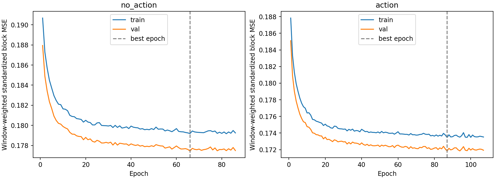
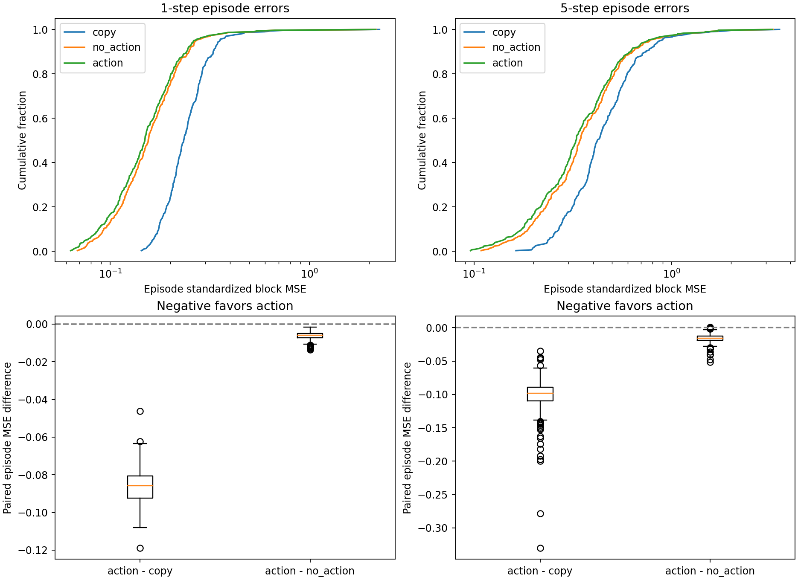
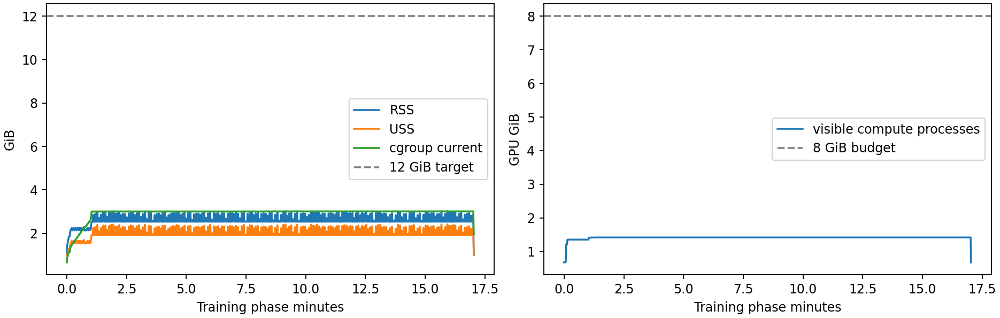

# P1-RETRAIN-028 修复后1000回合正式训练诊断报告
2026-09-28。**结论：seed11下，动作条件模型在完整300回合验证集一步和五步预测上均优于复制和无动作对照，四组配对总误差95%CI均低于0；这是P1a初步预测证据。** 验证集参与早停，未用独立最终测试，也未验证跨训练随机种子稳定性。不宣称P1完整研究出口、闭环控制收益或P2放行。本轮未扩大到9600回合，未新增RGB/语言或改变现有控制系统。

本轮仅验证修复D33时间索引后的P1a动作条件预测：train1000回合（seed0–999），val300回合（seed9600–9899），训练随机种子11。不使用test、不进入P2、不改变SAC最终动作、奖励/终止/动作/机器人配置。不从预测误差推断控制收益。

协议与版本：hidden64、lr3e-4、weight_decay1e-3、batch512、max200epochs、patience20、encode_batch128、FP32；max_train_batches=0。两个模型串行训练，相同数据、训练集统计、全局转移打乱、Adam及checkpoint规则。checkpoint以最低验证标准化block-MSE选取，early stopping沿用1e-7改善阈值；不选验证最优回合。action/no_action参数134609/134417，差192（0.143%），来自3维动作输入。

权威目录/home/ybc/projects/mm_husky_ws/src/modulation_rl，主包HEAD2a1348a及已有未提交P1工程修复；root与主包完整diff/status/HEAD、源码/encoder/配置SHA位于results/p1-retrain-20260928/diagnostic-r1。容器mmhusky-p1-trainval-1000-r1，镜像sha256:e674db49b8156fded725ba4de8c2faf81aa491a367a1e151eddae169a1dfc430，Python3.10.18/Torch2.7.1+cu128/NumPy1.23.5/torchvision0.22.1+cu128。实际SB3从主包scripts/stable_baselines3导入，pip check及CUDA真实反向退出0。Noetic/devel/PYTHONPATH由既有entrypoint加载。

数据协议SHA47b63b591355ab21702b1cd5fda694b5ee8ae309a2ba392b3b401aace3f82a18；encoder policy-100k.pt SHAe341262cf0e661151e988662be58317732d480c519a9f5a14993078398d6364d。train242892观测/241892一步/237892五步，val79893观测/79593一步/78393五步；计划1300、usable1300、采集异常0。train/val seed及分片SHA互斥。原采集记录initial_observation_sha256与floorplan_img FP32字节layout_sha256各1000/300唯一、交集0；没有近重复布局/场景族隔离检验，不宣称独立测试泛化。旧受污染test不使用。

现有checkpoint可加载完整epoch的model/optimizer/RNG/best/normalizer，但无精确resume CLI；中断保留latest不等于精确续训。新特征缓存由当前源/encoder/代码/数值后端身份构建，并由完成标记及分块SHA校验；禁止.partial误复用。runner初版冻结元数据observations误取最后episode起始offset，训练不使用该字段；原文件保留，正确计数另列split-counts-corrected.json。

实际训练与完整验证评测均已结束并退出0。完整执行记录：[任务日志](20260928-p1-retrain-diagnostic.md)；启动命令：[launch](20260928-p1-retrain-launch.sh)，原始训练/评测参数见diagnostic-r1/commands.json，wrapper仅监控与冻结、不改模型训练。

## 完整验证结果

误差沿用既有block-MSE：分别对41维机器人状态和1000维固定CNN特征取MSE，等权相加；standardized使用训练集逐维统计，raw在原固定特征尺度计算。每回合先平均所有有效窗口，再对300回合等权平均。一/五步仅用首帧和记录的动作/dt递归，五步中途不注入真实未来特征。早停曲线按窗口加权，与此回合等权报告口径不同。

| 步长 | 方法 | 标准化total | robot | map | raw total | raw robot | raw map |
|---|---|---|---|---|---|---|---|
| 1 | copy | 0.25341128 | 0.18625605 | 0.06715524 | 0.04982286 | 0.04930570 | 0.00051716 |
| 1 | no_action | 0.17333230 | 0.10627945 | 0.06705285 | 0.02552654 | 0.02500964 | 0.00051689 |
| 1 | action | 0.16707550 | 0.10008877 | 0.06698672 | 0.02434123 | 0.02382514 | 0.00051609 |
| 5 | copy | 0.49255173 | 0.30324212 | 0.18930961 | 0.06187543 | 0.06029767 | 0.00157776 |
| 5 | no_action | 0.40597408 | 0.21791923 | 0.18805485 | 0.03786195 | 0.03628858 | 0.00157337 |
| 5 | action | 0.38982477 | 0.20187394 | 0.18795083 | 0.03422440 | 0.03265301 | 0.00157139 |

| 步长 | 配对（action−对照） | total差值 | episode bootstrap 95%CI | 相对改善 | action更好回合 |
|---|---|---|---|---|---|
| 1 | action−copy | -0.08633579 | [-0.08732359, -0.08538705] | 34.07% | 300/300 |
| 1 | action−no_action | -0.00625681 | [-0.00649651, -0.00602055] | 3.61% | 300/300 |
| 5 | action−copy | -0.10272696 | [-0.10598248, -0.09975547] | 20.86% | 300/300 |
| 5 | action−no_action | -0.01614931 | [-0.01692312, -0.01538788] | 3.98% | 299/300 |

bootstrap单位是配对完整episode，10000次重采样、seed0，95%百分位区间；不把相关窗口当独立样本。区间只表示当前训练seed/所选模型在这些验证回合上的变化，不涵盖训练seed及验证选型不确定性。robot/map分块CI及raw配对CI完整保存于analysis.json和report.json。

| 步长 | 方法 | p25 | 中位数 | p75 | p95 | p99 | 最大值 |
|---|---|---|---|---|---|---|---|
| 1 | copy | 0.201901 | 0.234144 | 0.278032 | 0.355991 | 0.597505 | 2.250671 |
| 1 | no_action | 0.119592 | 0.155276 | 0.199798 | 0.270843 | 0.531489 | 2.159011 |
| 1 | action | 0.112683 | 0.149255 | 0.193520 | 0.263017 | 0.520055 | 2.151820 |
| 5 | copy | 0.335800 | 0.421891 | 0.565659 | 0.879082 | 1.580132 | 3.521674 |
| 5 | no_action | 0.246544 | 0.343932 | 0.478010 | 0.776120 | 1.490685 | 3.268770 |
| 5 | action | 0.232153 | 0.328482 | 0.462417 | 0.761625 | 1.490114 | 3.243448 |

逐回合六类误差、seed/终止原因/窗口数及两种配对差保存于per-episode-errors.csv，300回合×2步长共600行，全部纳入汇总。

| 步长 | 方法 | 采集成功组179回合 | 采集失败组121回合 |
|---|---|---|---|
| 1 | copy | 0.229278 | 0.289113 |
| 1 | no_action | 0.147547 | 0.211477 |
| 1 | action | 0.142020 | 0.204141 |
| 5 | copy | 0.412979 | 0.610267 |
| 5 | no_action | 0.328909 | 0.519979 |
| 5 | action | 0.314164 | 0.501753 |

分组来自固定采集策略原有结果，不是世界模型的控制成功率。

## 训练量、曲线与异常

| 模型 | 最佳epoch | 实际epoch | batch更新次数 | 样本呈现次数 | 最佳window-weighted val | 最终train/val |
|---|---|---|---|---|---|---|
| no_action | 66 | 86 | 40678 | 20802712 | 0.17744808 | 0.17924828/0.17749426 |
| action | 87 | 107 | 50611 | 25882444 | 0.17183997 | 0.17352575/0.17193381 |

每epoch完整241892训练窗口，共473batch（尾batch228样本）；max200epochs及patience20相同，实际epoch不同由早停产生。统计仅取训练集每个观测一次。最终action相对best val上升0.055%，no_action上升0.026%；全部loss有限，未观察持续发散或严重过拟合。val低于train，split分布差异仍可能影响选型，不能据此宣称泛化已验收。best.pt逐张量等于latest.training_state.best_state；latest含结束epoch的优化器/RNG/计数。重新评测的window-weighted val与最佳epoch曲线均绝对差0。

主要改善来自robot块：action相对no_action一步robot差−0.00619068、map差−0.00006613；五步robot差−0.01604529、map差−0.00010402。地图改善很小，不把总指标收益解释为已经准确学习地图演化。action五步误差为一步约2.33倍，递归累积仍存在，但在本轮两对照下仍较低。

高误差回合未剔除。seed9881（原采集collision_limit，413步）action一步2.151820、五步3.243448，为两个步长最大值，主要来自标准化map块1.914394/2.861131；raw尺度不呈现相同放大。该诊断只定位到特征块，尚未定位具体维度/环境原因。五步seed9699是唯一action总误差略高于no_action的回合，差+0.00083505；一步无此类回合。完整top10在analysis.json，下表列top5供接手检查，不参与筛选。

| 步长 | seed | 原终止 | action | no_action | copy |
|---|---|---|---|---|---|
| 1 | 9881 | collision_limit | 2.151820 | 2.159011 | 2.250671 |
| 1 | 9695 | collision_limit | 0.674014 | 0.679805 | 0.760700 |
| 1 | 9747 | success | 0.545966 | 0.551298 | 0.634840 |
| 1 | 9771 | ik_limit | 0.519793 | 0.531289 | 0.597128 |
| 1 | 9812 | ik_limit | 0.389421 | 0.394519 | 0.470633 |
| 5 | 9881 | collision_limit | 3.243448 | 3.268770 | 3.521674 |
| 5 | 9747 | success | 1.720295 | 1.727910 | 1.847965 |
| 5 | 9807 | ik_limit | 1.713483 | 1.718120 | 2.043831 |
| 5 | 9805 | success | 1.487858 | 1.488388 | 1.577426 |
| 5 | 9771 | ik_limit | 1.459003 | 1.468744 | 1.506954 |

## 资源和执行证据

训练（含索引/编码/统计/两模型/每epoch完整诊断/保存）1022.19s；完整val评测9.53s，合计1031.71s（17.20min）。启动前预检、后处理和文档另计。两阶段退出码均0，主容器退出0、OOMKilled=false。

| 项目 | 实测峰值/变化 | 预算/口径 |
|---|---|---|
| 进程树RSS | 3.029GiB | 正常≤12GiB，约1s采样 |
| 进程树USS | 2.415GiB | 约1s采样 |
| 容器cgroup peak | 3.032GiB | 硬16GiB，内核累计含页缓存 |
| Torch allocated/reserved | 69.246/116.000MiB | 子进程累计峰值 |
| 单GPU进程采样 | 784MiB | 约1s采样 |
| GPU compute进程合计 | 1482MiB | ≤8192MiB，含runner CUDA检查context |
| 任务swap | 0bytes | swap.max=0 |
| 宿主swap变化 | 0bytes | 已有约25.84GiB swap保留，未扩容 |
| 宿主MemAvailable最小 | 235.696GiB | 启动前≥32GiB |
| 缓存磁盘 | 1.252GiB | 完整train/val两缓存 |

passed_budget=true。GPU8GiB是监测验收阈值，未声称CUDA有8GiB显存硬配额；RAM/swap为实际Docker/cgroup硬限制。每秒RSS/USS/GPU/cgroup/swap见*-resources.jsonl，单PID显存不能替代合计。无worker、无全量地图加载/concatenate，NPY映射进程全局≤4块/512MiB。主包沿用验收代码，本轮未改源码。

实际命令冻结于diagnostic-r1/commands.json；Docker完整命令见本目录20260928-p1-retrain-launch.sh，runner/analysis仅监控与后处理。修改仅根doc报告/进度/决策/任务脚本及新results。完整依赖/模块路径在pip-freeze.txt、pip-check.log、frozen-metadata.json；dirty diff、HEAD、源码/encoder/配置哈希在*-diff.txt、*-head.txt、source-hashes.json、freeze-hashes.json。源数据保留于results/p1a-20260923/dataset-v2-10k，不覆盖或重采；旧模型/报告与用户修改保留。

独立16GiB/no-swap隔离容器重新运行全65项Python测试通过，退出0，351项既有deprecation warnings，17.82s，证据tests.log。分析容器退出0：best/latest加载一致、normalizer一致、完整epoch/全300回合/有限数值、best-val重评差0、资源预算，见analysis.json。学习曲线已生成并目视检查。

监控曾只读no_action曲线，误把训练完成后的模型切换判断为变慢，已更正，未发信号/改代码/重启。冻结metadata的observations字段错误保留并另写核正计数，不参与训练。报告生成命令首次因字符串闭合错误退出1，未写入结果、未影响训练；后改为本目录report-build.py成功生成。本轮实际训练/评测未失败或中止。

## 产物和交接

根路径：`/home/ybc/projects/mm_husky_ws/results/p1-retrain-20260928/`。

- `protocol-1000/dataset.json`：固定数据清单，无test。
- `trainval-1000-r1/`：action.pt/no_action.pt最佳权重、*-latest.pt结束epoch状态、完整*-curve.jsonl、summary.json；产物SHA见analysis.json。
- `feature-cache/*/complete.json`及FP32 NPY块：当前身份完整缓存，训练/评测均校验后读取。
- `diagnostic-r1/prediction-val/report.json`：原始全val指标、逐回合误差、配对CI。
- `diagnostic-r1/analysis.json`、`per-episode-errors.csv`：分布、raw CI、异常、核查结果、权重/报告/曲线SHA。
- `diagnostic-r1/*-resources.jsonl`、`resource-summary.json`、`*-result.json`、`container-{before,after}.json`、`launcher-exit-code.txt`：资源和退出证据。
- `diagnostic-r1/{train,prediction,analysis,tests}.log`及上级`trainval-1000-r1.log`：完整日志。
- [执行记录](20260928-p1-retrain-diagnostic.md)：开始/切换/结束/问题及命令。

建议保持D27配置，开展seed22/33验证（本轮未启动），先确认动作相对无动作约4%的增益跨训练seed成立；同时完善跨版本曝光登记和布局/场景族隔离，冻结全新未曝光独立测试集。另查seed9881地图特征维度、标准化和真实变化，不剔除该回合，不反复调验证协议追求有利结果。不从本轮结果推断必须扩大到9600回合。

本轮完成实训与全val评测的诊断，P1a取得初步正向证据；独立test及跨seed未验收，P1-B/P2/P3/P4/P5不因此放行。接手先读报告和日志、核对产物/进程，再登记任务；不得把加载latest权重称为精确续训。
